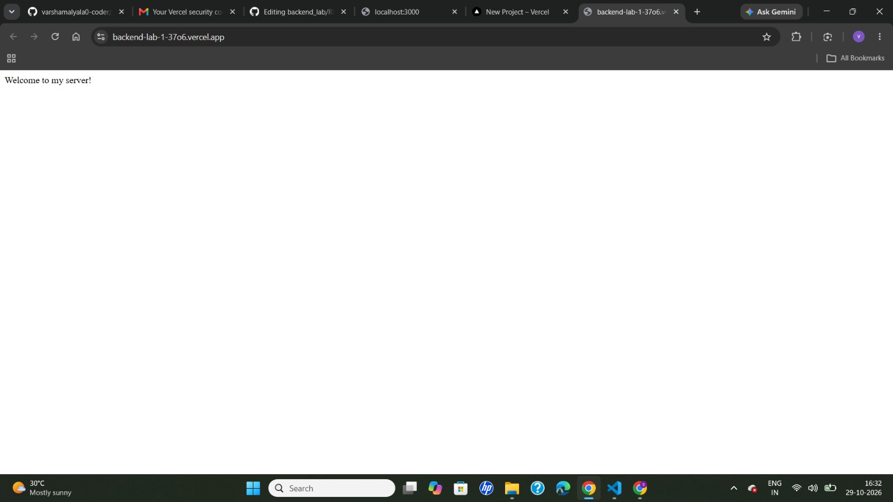
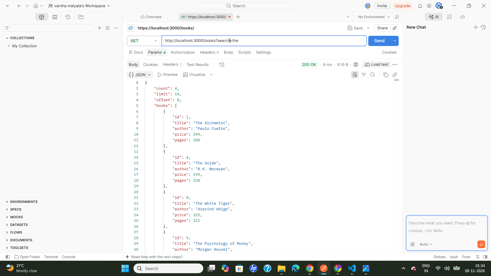
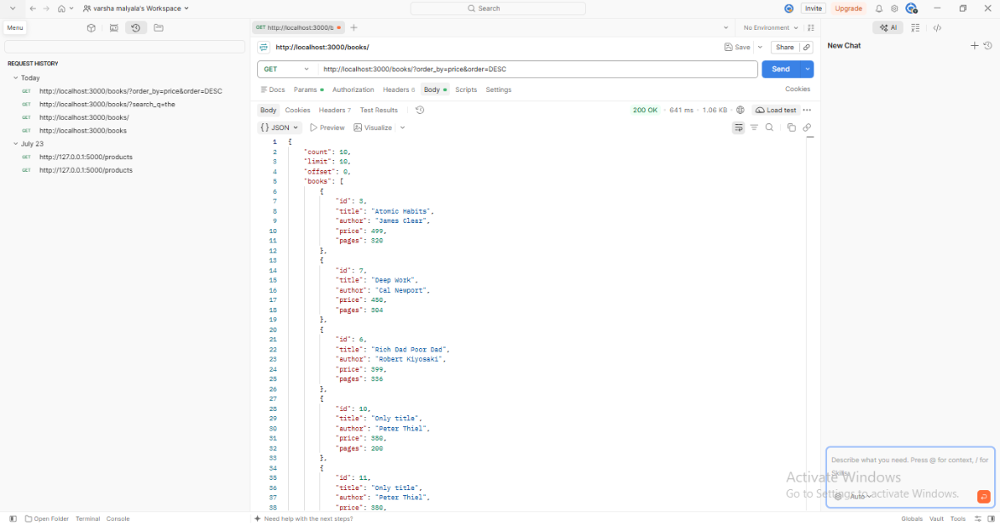
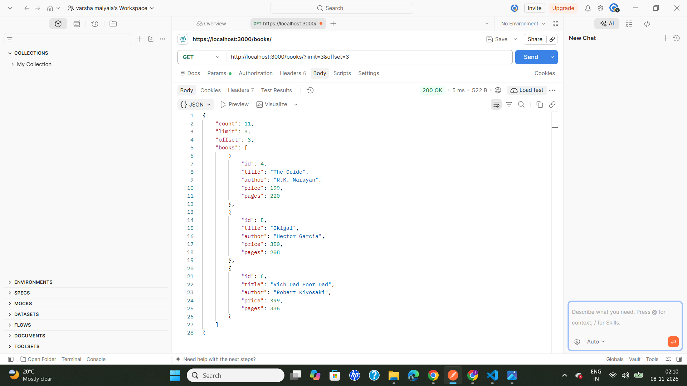
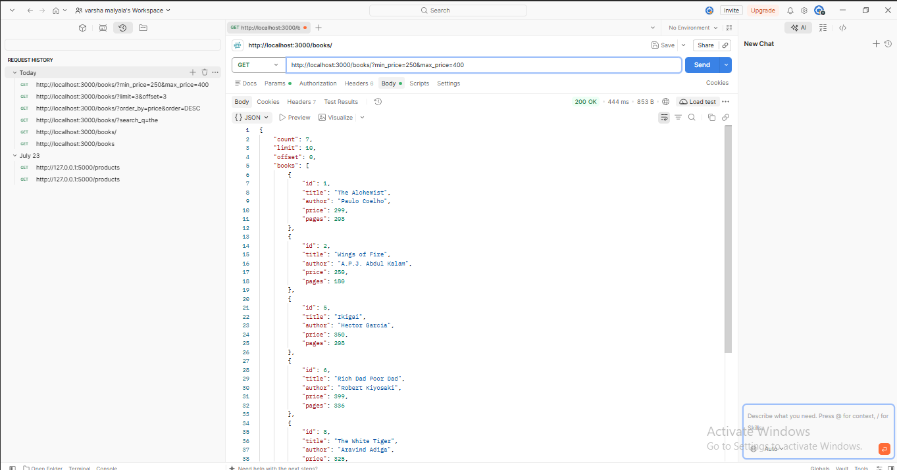
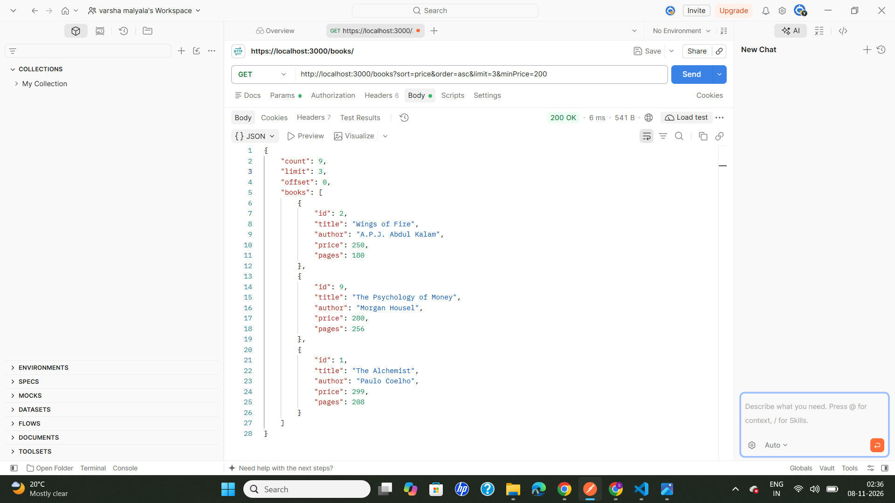
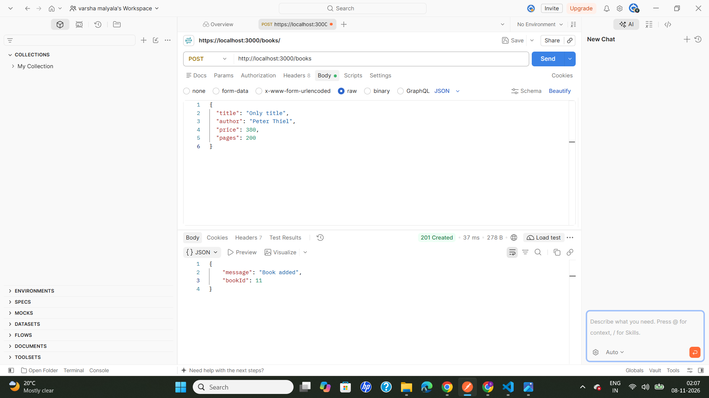
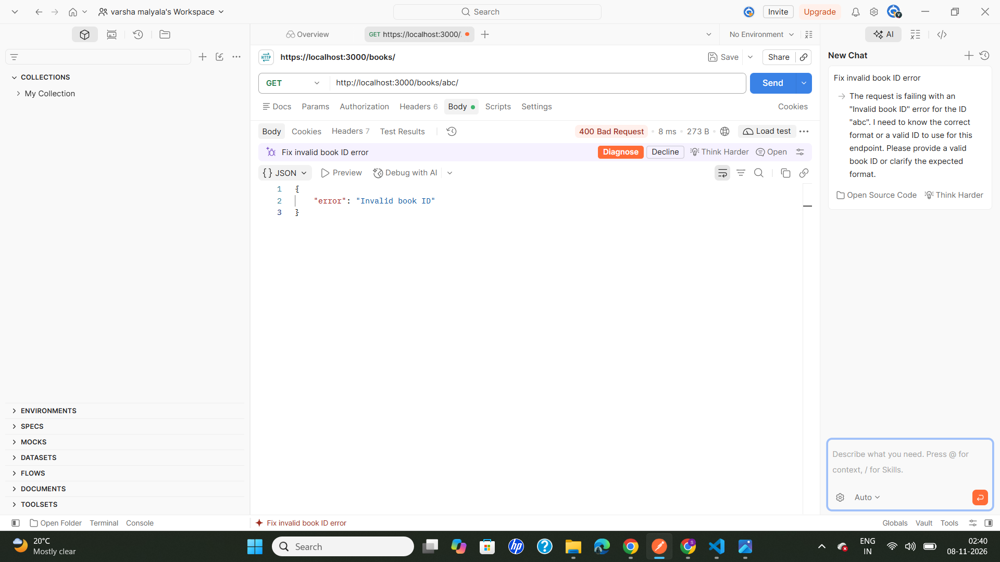
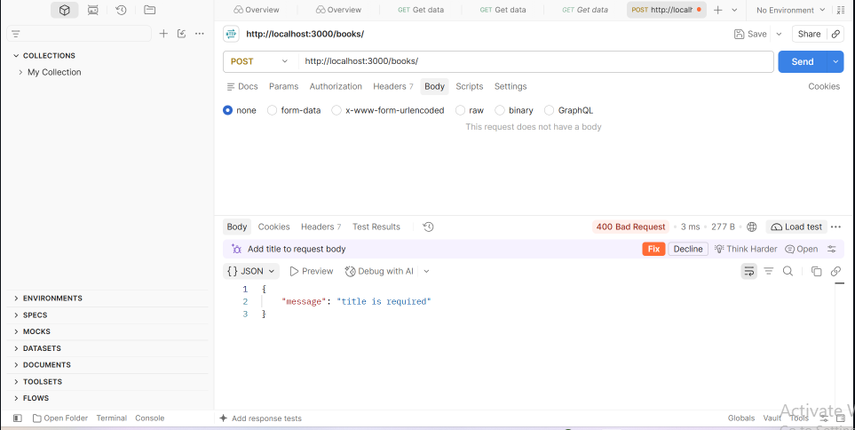
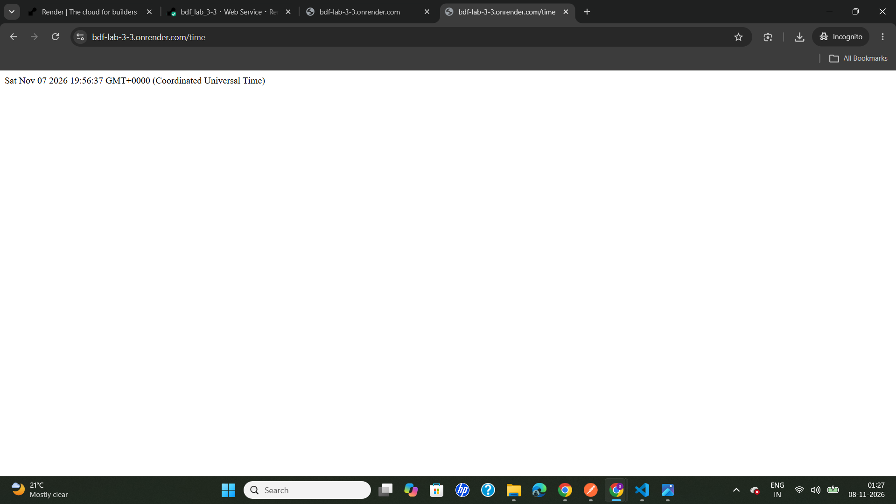

# Lab 3: REST API, query parameters, validation, debugging

**Name:** MALYALA VARSHA · **Registration number:** 252U1R9089 · **Section:** 111

**Live link:** https://bdf-lab-3-3-zpa7.onrender.com/books

## How to run

```bash
git clone https://github.com/varshamalyala0-coder/bdf_lab_3.git
cd bdf_lab_3
npm install
npm start
```

The server runs on `http://localhost:3000`.

Open Postman and send requests to `http://localhost:3000/books`.

To stop the server, press `Ctrl + C` in the terminal.

## Endpoints

| Method | Path | Description | Success status |
|---|---|---|---|
| GET | `/books` | List books with search, sort, pagination and price filter | 200 |
| GET | `/books/:id` | Get one book by ID | 200 |
| POST | `/books` | Add a book | 201 |
| PUT | `/books/:id` | Update a book | 200 |
| DELETE | `/books/:id` | Delete a book | 200 |

### Query parameters for GET /books

| Parameter | Default | Meaning |
|---|---|---|
| `search` | empty | Case-insensitive partial match on book title or author |
| `sort` | none | Field to sort by: `title`, `author`, `price`, or `pages` |
| `order` | `asc` | Sort direction: `asc` or `desc` |
| `limit` | `10` | Maximum number of books to return |
| `offset` | `0` | Number of matching books to skip |
| `minPrice` | none | Only books with price at or above this value |
| `maxPrice` | none | Only books with price at or below this value |

### Example GET requests

| Feature | Request |
|---|---|
| Get all books | `GET /books` |
| Search by title or author | `GET /books?search=the` |
| Sort by price ascending | `GET /books?sort=price&order=asc` |
| Sort by price descending | `GET /books?sort=price&order=desc` |
| Pagination | `GET /books?limit=3&offset=3` |
| Price range | `GET /books?minPrice=200&maxPrice=400` |
| Combined filters | `GET /books?search=a&sort=price&order=asc&limit=5&minPrice=200&maxPrice=400` |

### Status codes

| Code | When |
|---|---|
| 200 | Successful GET, PUT or DELETE |
| 201 | Book created successfully |
| 400 | Invalid input, invalid ID, invalid query parameter, or missing required fields |
| 404 | Book ID does not exist or route is not found |
| 500 | Unexpected server error |

## Postman test list

Use `http://localhost:3000` as the base URL when the local server is running.

| # | Request | Expected |
|---|---|---|
| 1 | GET `/books` | 200 |
| 2 | GET `/books?search=the` | 200 |
| 3 | GET `/books?sort=price&order=asc` | 200 |
| 4 | GET `/books?sort=price&order=desc` | 200 |
| 5 | GET `/books?limit=3&offset=3` | 200 |
| 6 | GET `/books?minPrice=200&maxPrice=400` | 200 |
| 7 | GET `/books?order=password` | 400 |
| 8 | GET `/books?sort=password` | 400 |
| 9 | GET `/books?limit=0` | 400 |
| 10 | GET `/books?minPrice=500&maxPrice=200` | 400 |
| 11 | GET `/books/999` | 404, if book ID 999 does not exist |
| 12 | POST `/books` with a valid JSON body | 201 |
| 13 | POST `/books` without a title | 400, if title validation is enabled |
| 14 | PUT `/books/9` with a valid JSON body | 200, if book ID 9 exists |
| 15 | DELETE `/books/9` | 200, if book ID 9 exists |

### POST request body

Select **Body → raw → JSON** in Postman:

```json
{
  "title": "New Book",
  "author": "Peter Thiel",
  "price": 380,
  "pages": 200
}
```

Expected status: `201 Created`.

### PUT request body

Select **Body → raw → JSON** in Postman:

```json
{
  "title": "Updated Title",
  "author": "Peter Thiel",
  "price": 380,
  "pages": 200
}
```

Expected status: `200 OK`, when the selected book ID exists.

## Screenshots

The screenshot files are stored in the root directory of this repository. The image names below must match the repository filenames exactly.



### Search



### Sort by price



### Pagination



### Price range filter



### Combined filters



### POST returns 201



### PUT returns 200


### DELETE returns 200


### Missing book returns 404


### Invalid book ID



### Invalid sort order


### Invalid price


### Missing title



### PUT on a missing book


### Time endpoint screenshot



## Notes

- Query parameter names are case-sensitive and must match the implementation: `search`, `sort`, `order`, `limit`, `offset`, `minPrice`, and `maxPrice`.
- The `sort` field is restricted to `title`, `author`, `price`, and `pages`.
- `order` must be either `asc` or `desc`.
- The GET `/books` code uses an in-memory JavaScript array (`books`). It is not a SQLite database implementation.
- Book records added or changed at runtime may be reset when the server restarts, depending on how the data is initialized in `server.js`.

### Debugging notes

- **Postman `ECONNREFUSED 127.0.0.1:3000`:** The local server was not running. Start it from the VS Code terminal using `npm start`, then send the request again.
- **400 `Order must be either asc or desc`:** The order value was supplied in uppercase or was not one of the accepted values. Use `order=asc` or `order=desc`.
- **400 `Request body must be a valid JSON object`:** The request body was not configured as raw JSON or the JSON syntax was invalid. Select **Body → raw → JSON** and enter a valid JSON object.
- **400 `title is required`:** The POST request did not contain the required title. Add the `title` field to the JSON body.
- **404 `Book not found`:** The requested ID does not exist in the current books array. First send `GET /books` and use an ID returned by that request.

### Debugging reference: common errors and fixes

| Error | Cause | Fix |
|---|---|---|
| `ECONNREFUSED 127.0.0.1:3000` | Local server is not running | Run `npm start` from the project folder |
| `Order must be either asc or desc` | Unsupported `order` value | Use `asc` or `desc` |
| `Invalid sort field` | Unsupported `sort` value | Use `title`, `author`, `price`, or `pages` |
| `Request body must be a valid JSON object` | Body is missing, malformed, or not sent as JSON | Select raw → JSON and provide a valid object |
| `title is required` | Required title field is missing | Include a non-empty `title` in the request body |
| `Book not found` | The supplied book ID does not exist | Get the available IDs using `GET /books` |

